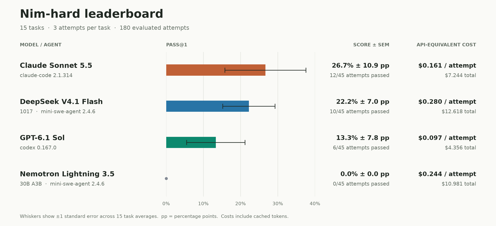
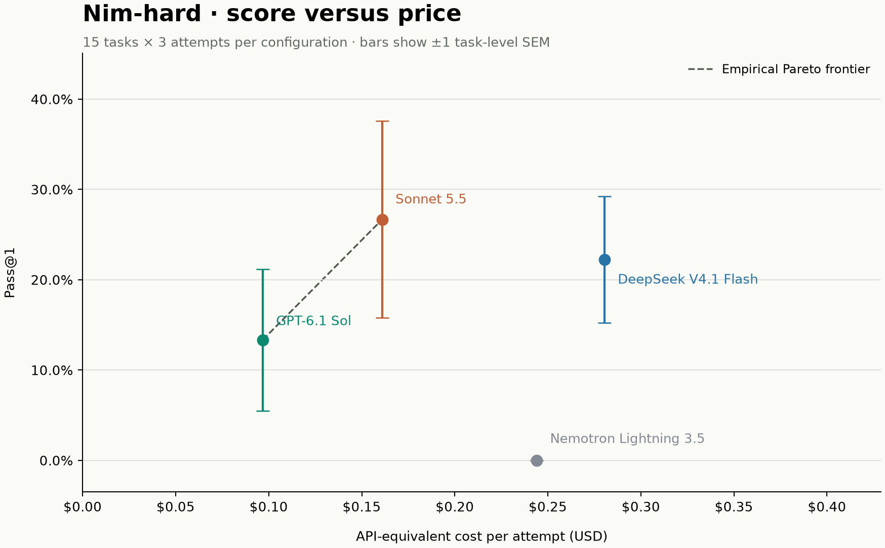

## Nim Bench Hard

15 tasks from the [Nim compiler repository](https://github.com/nim-lang/Nim), published as `josancamon19/nim-hard@v1.2.0`. 3 attempts per task (45 per configuration; 180 retained attempts).

### Leaderboard

Pass@1 is the mean of the 15 task scores, where each task score is its number of successful attempts divided by three. Equivalently, it is successful attempts / 45; it is not the probability of succeeding at least once in three tries. SEM is `stdev(task_scores, ddof=1) / sqrt(15)`, reported in percentage points. This uses tasks as the unit of replication; a zero empirical SEM when all observations fail does not establish a zero true success probability.

### Verifier

The verifier restores trusted source and build dependencies at each task's starting revision, then replaces only `compiler/` and `lib/` with the submitted source trees. It rebuilds Nim with a trusted bootstrap and checks an independent compile-and-run smoke program. It then calls the rebuilt Nim binary on protected fixtures and checks compilation, exit status, and specified program output. It never imports compiler internals. The 15 tasks contain 474 cases: 17 fail-to-pass regression cases and 457 pass-to-pass preservation cases. All 17 regression cases compile and run; 17 preservation cases check successful compilation only. The verifier returns **1 only when the compiler builds, the smoke check passes, and every case passes**; ordinary solution failures return 0. Infrastructure failures are kept separate and retried. Case-level evidence is in each trial's `verifier/report.json` and `verifier/ctrf.json`.

### Task Sample

`nim-pr-20529` starts at [commit `5334dc9`](https://github.com/nim-lang/Nim/commit/5334dc921fc177bf6253256dcd579baf244f1ad8) and covers two compiler crashes: [issue #12938](https://github.com/nim-lang/Nim/issues/12938), triggered by an integer argument specifying a generic array's size, and [issue #14193](https://github.com/nim-lang/Nim/issues/14193), encountered in macro-generated code using generic array sizes. The upstream fix is [PR #20529](https://github.com/nim-lang/Nim/pull/20529). The task includes snapshots of both issue reports in the workspace, with this exact instruction:

> Fix the problems reported in `/workspace/12938.md`, `/workspace/14193.md` for `/workspace/Nim`.

Across 12 trials, **4 passed**. Trajectories and verifier logs show:

- **Sonnet 5.5: 3/3.** Passed perfectly.
- **DeepSeek V4.1 Flash: 1/3.** Wrong success criterion: both failures wrote tests expecting compiler errors instead of successful compilation of the valid programs.
- **GPT-6.1 Sol: 0/3.** Stopped with incomplete work: two runs reverted their attempted fixes and left the crashes; the third only added an error diagnostic and skipped final validation.
- **Nemotron Lightning 3.5: 0/3.** Build regressions: invalid indentation in two runs, a duplicate function declaration in the third.

### Pareto Frontier

All retained trials, agent trajectories, submitted source artifacts, and verifier logs are available [here](https://hub.harborframework.com/jobs/a05e726f-555c-47fb-bf0d-7fdc7547bb0f).
